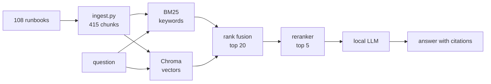

# sre-hybrid-rag

Ask a question about a Kubernetes or Prometheus alert and get an answer from real runbooks, with citations. Hybrid search finds the right runbook for 77% of test questions, against 50% for keyword search alone. Everything runs locally and costs nothing.

## Demo

```
$ python answer.py "what is the impact when etcd has no leader?"
When etcd has no leader, the Kubernetes API will not work as expected, and cluster
cannot process any writes or reads, with queued requests until a new leader is
elected. Operations that preserve the health of the workloads cannot be performed. [1]

Sources:
  [1] etcd/etcdNoLeader.md#1  (etcdNoLeader > Impact)

$ python answer.py "How do I rotate my AWS IAM access keys?"
Not in the docs.
```

## Why it matters

At 3 a.m. an on-call engineer does not type the alert's exact name; they type what they see ("pod keeps restarting"). Keyword search misses that, and vector search alone is weak on exact alert names. This project combines both and measures the difference.

## How it works



| File | Job |
|---|---|
| `ingest.py` | Split each runbook by heading into chunks, each labelled with its alert and section |
| `search.py` | BM25 search, vector search, and Reciprocal Rank Fusion of the two |
| `rerank.py` | Re-order the top 20 candidates with a cross-encoder |
| `answer.py` | Build the prompt, call the model, map `[n]` citations back to chunks |
| `evals/` | 30 labelled questions and the script that scores each search method |

## Results

30 questions, each labelled with the runbook that answers it (8 use the exact alert name, 22 are paraphrases).

| Method | recall@5 | MRR | recall@5 (exact) | recall@5 (paraphrase) |
|---|---|---|---|---|
| BM25 | 0.50 | 0.41 | 0.75 | 0.41 |
| Dense | 0.63 | 0.49 | 0.88 | 0.55 |
| Hybrid | 0.77 | 0.56 | 0.88 | 0.73 |
| Hybrid + rerank | 0.77 | 0.62 | 1.00 | 0.68 |

- **recall@5:** the right runbook is somewhere in the top 5.
- **MRR:** how high it is ranked (1st place scores 1, 2nd scores 0.5, missing scores 0).

Hybrid search finds more than either search alone. Reranking does not find more, but it ranks the right runbook higher. On paraphrases the reranker lost one question it should have kept.

Cost per query: 0 USD. All models run on the local machine.

## Quickstart

Needs Python 3.13, `make`, and [Ollama](https://ollama.com) for the last step.

```bash
make setup index                 # install, download runbooks, chunk, embed
make lint test eval              # lint, run the tests, print the results table
ollama pull llama3.2 && .venv/bin/python answer.py "pod keeps restarting, what should I check?"
```

To compare the search methods on one question: `.venv/bin/python search.py "pod keeps restarting"`.

## Design decisions

- **Split by heading, not by size.** A runbook section (Meaning, Impact, Diagnosis, Mitigation) is one idea. The longest is 1,705 characters, so no size-based splitting is needed.
- **Keep the heading with every chunk.** Half of the chunks are under 100 characters. "Clock not synchronising." is only findable with its alert name attached.
- **Rank fusion on positions, not scores.** BM25 scores and vector distances are on different scales and cannot be added. Fusion is nine lines, written by hand.
- **Retrieve 20, rerank to 5.** The reranker is accurate but slow, and it cannot recover a chunk that the first stage never returned.
- **The model is passed in.** Tests use a fake model, so they are fast, free and repeatable. Changing provider is one line.
- **An exact refusal sentence.** "Not in the docs." can be checked by code.
- **Citations are parsed, not trusted.** A cited number that matches no chunk is dropped.

## Tests

```bash
make test
```

28 tests cover chunking, both searches, fusion, reranking, prompt building, citation parsing and the metric. Search tests use the real embedding models on a five-chunk fixture. Answer tests use a fake model and need no Ollama.

## Limitations and next steps

- **Citations do not prove correctness.** With a small local model, an answer can mix in advice from an unrelated chunk and still cite a relevant one. Next step: check each claim against the chunk it cites.
- **Three of 30 questions fail in every method.** The right runbook is not in the top 20 candidates. A stronger embedding model is the first thing to try.
- **Small evaluation set.** One question is 3.3 points, so small differences are noise.
- **Retrieval is measured, answer quality is not.**
- **BM25 has no stop-word filter,** which may explain why some exact-name questions miss.

## Where it fits

This is the runbook-search tool of a larger SRE Copilot, where an agent uses it together with a safe SQL tool and a human approval step.

## Credits

- Runbooks: [prometheus-operator/runbooks](https://github.com/prometheus-operator/runbooks) (Apache-2.0), downloaded by `make corpus` and not stored in this repo.
- Learned from: [rithvikshettyy/Hybrid-Search-RAG-over-Internal-Docs](https://github.com/rithvikshettyy/Hybrid-Search-RAG-over-Internal-Docs), [NirDiamant/RAG_Techniques](https://github.com/NirDiamant/RAG_Techniques), [pixegami/rag-tutorial-v2](https://github.com/pixegami/rag-tutorial-v2).
